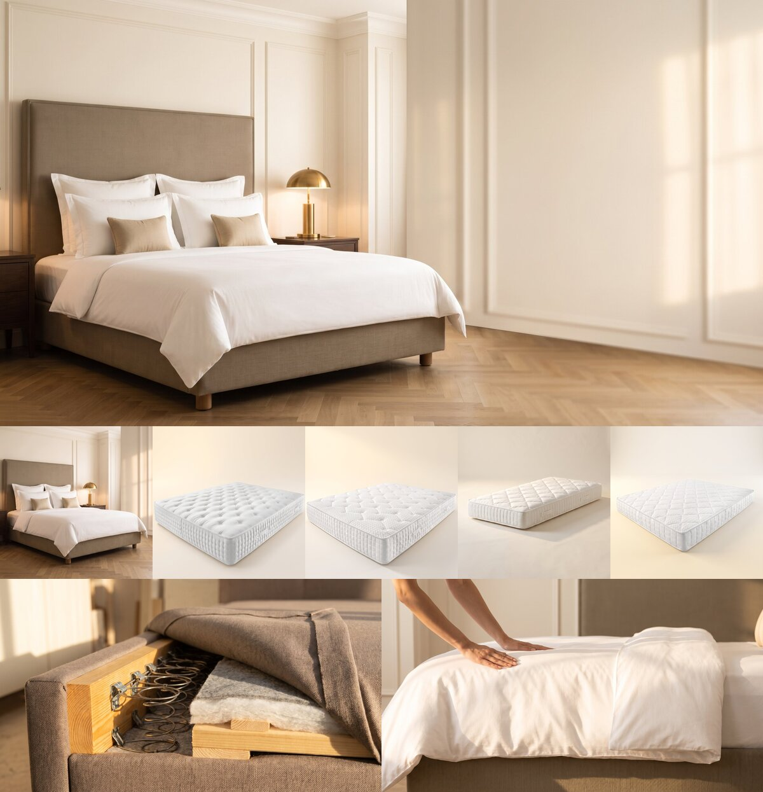

# LYONBED – Brand Asset Pack

**LYONBED® – luxury and comfort**, das Hotelbett für Zuhause. Von Hantermann – Der Hotelausstatter.

## Inhalt

| Pfad | Inhalt |
|---|---|
| [`palette.md`](palette.md) | Farbpalette mit Hex-Werten und CSS-Variablen |
| [`claude-design-brief.md`](claude-design-brief.md) | Brief für Claude Design (Design System „Grand Suite“) |
| [`embed-guide.md`](embed-guide.md) | HTML/CSS-Snippets: Hero, Produktkarten, Logo, Favicon, Texturen |
| [`website-notes.md`](website-notes.md) | Vormerkungen für den Website-Bau (Hotelkarte, Produktdaten) |
| [`manifest.md`](manifest.md) | Alle Dateien, Prompts, Job-IDs und Credits |
| `logo/` | Logo als Vektor (SVG) mit Signet, PNG-Exporten und Favicons |
| `banner/` · `heroes/` · `detail/` · `lifestyle/` | Fotos in Originalauflösung (2k) |
| `web/` | Web-optimierte Versionen der Fotos (WebP + JPG) |
| `motion/` | Poster für das Hero-Video (Video folgt) |
| `refs/` | Referenzbilder für die Generierung |
| `quellen/` | Ursprüngliche Unterlagen (Broschüre, Beschreibung, Vergleich) |

## Status
- [x] 8 Bilder (nano_banana_pro)
- [x] Logo vektorisiert
- [x] Palette, Brief, Embed-Guide
- [ ] Hero-Video: `seedance_2_0` erfordert den Higgsfield-Tarif Pro
- [ ] Website inklusive Hotelkarte (Deutschland, Mock-Daten)
